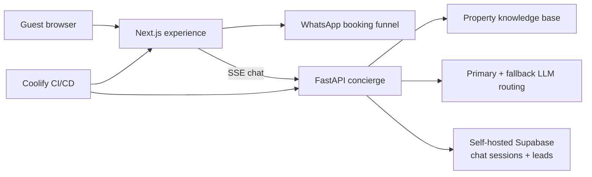

# HappyNest — live farm-stay website and AI concierge

[](https://happynestfarm.in)


My family had a real luxury farm stay but no technical team, booking funnel, or automated guest-support system. I built and now operate all three.

HappyNest is a live Next.js property experience with a 91-frame interactive hero, WhatsApp booking flow, and an AI concierge that answers property questions and stores lead context in self-hosted Supabase. The full stack is deployed through infrastructure I operate, with zero recurring hosting cost.

## What makes this more than a website

- **Real business use:** the site presents a working farm stay in Sohna, Haryana and routes interested guests into a WhatsApp booking flow.
- **AI concierge:** a FastAPI service streams answers with Server-Sent Events and persists chat sessions and lead data.
- **Simple retrieval by design:** the complete property knowledge base is small enough for cache-augmented generation, avoiding vector-database latency and operational overhead.
- **Provider resilience:** the LLM client supports a primary provider and fallback path rather than assuming one API is always available.
- **Owned deployment:** Next.js, the agent service, and Supabase persistence run through self-hosted infrastructure and a repeatable deployment path.

## System architecture



## Product experience

- Canvas-scrubbed 91-frame GSAP/ScrollTrigger hero
- Twelve content sections, responsive layout, and dark/light mode
- Property catalog, amenities, rooms, experiences, rules, location, and virtual tour
- WhatsApp booking CTA and event instrumentation
- Embedded concierge with session persistence and lead capture

## Why CAG instead of a vector database?

The property knowledge base is compact and stable. Injecting the complete curated context keeps the system easier to debug, removes retrieval latency, and avoids another stateful dependency. A vector store would become useful if the catalog grew substantially or required frequent document ingestion; it is unnecessary complexity at the current scale.

## Deployment

The public site is available at [happynestfarm.in](https://happynestfarm.in). The application uses a self-hosted deployment path so I retain control over the runtime, database, logs, and provider configuration.

## Run locally

### Prerequisites

- Node.js 20+
- Python 3.12+ and `uv`
- At least one configured LLM provider
- Supabase project for persisted chat sessions and leads

### Install and configure

```bash
make install
cp agent/.env.example agent/.env
cp -n .env.example .env.local
```

Fill in the provider and Supabase values, then apply the SQL migrations in `agent/supabase/migrations/` through the Supabase SQL editor.

### Start the complete development stack

```bash
make dev
```

This starts the FastAPI agent on port `8000` and the Next.js application on port `3000`.

Individual commands:

```bash
make agent-server-reload
make web-dev
curl http://localhost:8000/health
```

## Documentation

- [Design system](./docs/DESIGN.md)
- [Property details](./docs/property-details.md)
- [Development guide](./docs/README.md)
- [Agent documentation](./agent/README.md)

## Stack

| Layer | Technology |
|---|---|
| Web | Next.js, TypeScript, GSAP, Tailwind CSS |
| AI API | FastAPI, SSE, provider fallback |
| Data | Self-hosted Supabase/PostgreSQL |
| Delivery | Docker, Coolify, private/public ingress |

## License

MIT — use it, fork it, and build on it.
